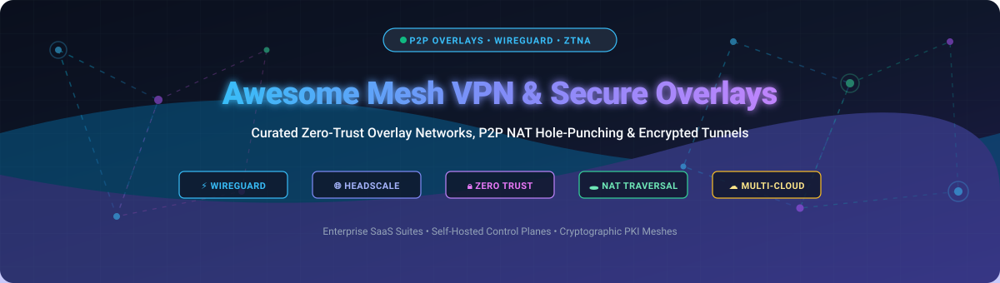

  

# 🌐 Awesome Mesh VPN & Secure Overlay Networking

**Curated Directory of Enterprise SaaS Platforms & Open-Source Projects for WireGuard Mesh Overlays, Zero-Trust Network Access (ZTNA), NAT Hole-Punching & Encrypted P2P Tunnels**

---

## 📑 Table of Contents
- [📌 Overview & SEO Highlights](#-overview--seo-highlights)
- [📊 Sector Overview & Market Dynamics](#-sector-overview--market-dynamics)
- [🏢 SaaS & Hosted Platforms](#-saas--hosted-platforms)
- [💻 Open-Source GitHub Projects](#-open-source-github-projects)
- [🤝 How to Contribute](#-how-to-contribute)
- [💖 Support & Sponsorship](#-support--sponsorship)
- [📈 Star History](#-star-history)
- [⚠️ Disclaimer](#️-disclaimer)

---

## 📌 Overview & SEO Highlights

Welcome to the comprehensive curated directory on **Mesh VPNs**, **Secure Overlay Networking**, and **Zero-Trust Network Access (ZTNA)**. Modern cloud architectures, multi-cloud Kubernetes clusters, homelab infrastructures, and distributed remote teams require direct, encrypted peer-to-peer (P2P) connections that seamlessly punch through firewalls and NATs without exposing public static IPs or opening ingress firewall ports.

### 🔍 Key Focus Areas:
- ⚡ **WireGuard Mesh Overlays**: High-performance, kernel-grade cryptographic tunnels creating full-mesh or hub-and-spoke virtual topologies.
- 🔒 **Zero-Trust Network Access (ZTNA)**: Identity-verified, least-privilege resource access policies replacing legacy hub-and-spoke VPN concentrators.
- 🕳️ **P2P NAT Hole-Punching & ICE/STUN/DERP**: Automatic traversal of symmetric and cone NATs via encrypted STUN/TURN/DERP relays and WebRTC-inspired discovery.
- 🛠️ **Self-Hosted Control Planes**: Self-sovereign coordination and key-distribution servers (such as `Headscale`, `NetBird`, and `Nebula` lighthouses) giving full control over coordination, private DNS (MagicDNS), and ACLs.
- ☁️ **Multi-Cloud & Kubernetes Pod Mesh**: Overlay interconnects extending private CIDR routing across AWS, GCP, Azure, bare-metal servers, and edge IoT devices.

---

## 📊 Sector Overview & Market Dynamics

The global enterprise Secure Remote Access, Zero Trust Network Access (ZTNA), and Cloud VPN market is estimated at **$48.5 Billion to $54.5 Billion** (with the dedicated standalone ZTNA segment growing from **~$1.6 Billion** toward over **$4.2+ Billion** by 2030, registering a rapid CAGR of ~25.5%). 

The sector displays a **moderately fragmented and bifurcated market dynamic**: the upper enterprise tier is led by broad SASE/ZTNA edge conglomerates (Cloudflare, Check Point / Perimeter 81, and Nord Security) competing for corporate remote-workforce consolidation, while the infrastructure layer is fiercely contested by agile, product-led WireGuard mesh platforms (Tailscale, NetBird, Netmaker, and ZeroTier). High developer velocity and strong open-source gravity (notably `Headscale` and `WireGuard`) prevent a strict "winner-take-all" outcome, ensuring active coexistence between enterprise SaaS clouds and self-hosted, sovereign mesh overlays.

---

## 🏢 SaaS & Hosted Platforms

*Enterprise and cloud-hosted mesh networking suites sorted by estimated corporate scale (annual revenue/valuation in descending order).*

| Platform | Corporate Scale (Est. Revenue / Valuation) | Starting Price | Free Tier Limits / Free Trial Duration | Primary Focus & Capabilities |
| :--- | :--- | :--- | :--- | :--- |
| **[Cloudflare One (Zero Trust)](https://cloudflare.com)** | ~$2.17B Annual Revenue / ~$69B+ Market Cap (NYSE: NET) | **$7/user/month** (Pay-as-you-go plan) | **Free forever plan**: Up to 50 users, 24-hour activity log retention, and 2 CASB integrations | 🌐 **Global Anycast ZTNA & Edge Mesh**: Enterprise-scale edge routing using WireGuard/MASQUE tunnels, DNS filtering, and secure application gateways. |
| **[Perimeter 81 (Check Point SASE)](https://perimeter81.com)** | Acquired for $490M (Parent: Check Point ~$2.4B+ Revenue / ~$22B Market Cap) | **$8/user/month** (Essentials plan; 10 user minimum) | **30-day free trial** via Check Point Infinity Portal (guided PoC available) | 🛡️ **Cloud-Native Enterprise SASE**: Centralized zero-trust security combining private wire-speed gateways, device posture checks, and firewall-as-a-service. |
| **[NordLayer](https://nordlayer.com)** | Parent Nord Security: $3B Valuation ($100M+ funding / ~$9M+ product ARR) | **$8/user/month** (Lite plan, billed annually; 5 user minimum) | **14-day money-back guarantee trial** (full access across all platforms with 100% refund guarantee) | 🏢 **Business Adaptive Security**: Turnkey remote-access VPN and ZTNA mesh designed for distributed SMEs with automated SSO enforcement and dedicated gateway IPs. |
| **[Tailscale](https://tailscale.com)** | $1.45B–$1.5B Valuation (Series C $160M / ~$45M+ estimated ARR) | **$8/user/month** (Standard plan) | **Free forever plan (Personal)**: Up to 6 users, unlimited devices, and 3 ACL groups | ⚡ **Zero-Config WireGuard Mesh**: Category-leading developer mesh VPN featuring MagicDNS, SSO identity sync, subnet routers, exit nodes, and ACL tags. |
| **[Twingate](https://twingate.com)** | $400M Valuation ($67M total funding / Series B) | **$5/user/month** (Teams plan, billed annually) | **Free forever plan (Starter)**: Up to 5 users, 50 resources, 2 networks, 1 admin | 🔒 **Modern Enterprise ZTNA**: Zero-port-exposure connector architecture replacing legacy VPNs with identity-verified split tunneling and least-privilege routing. |
| **[ZeroTier Central](https://zerotier.com)** | $15.9M Funding (Series A led by Battery Ventures / ~$5M+ estimated ARR) | **$18/month** (Essential plan, includes 10 devices; $2/device/mo extra) | **Free forever plan (Personal)**: Up to 10 connected devices, 1 network admin, 1 network (non-commercial use) | 🔌 **Layer-2/3 Global Virtual Switch**: Cloud-hosted controller uniting Ethernet virtualization, micro-segmentation, and P2P mesh across cloud, desktop, and IoT. |
| **[Defined Networking](https://defined.net)** | $18.8M Funding (Backed by a16z, Coatue, Slack Fund, Salesforce) | **$1/host/month** (Pro plan, unlimited hosts) | **Free forever plan**: Up to 100 hosts, 2 external host routes, 1 managed lighthouse/relay, unlimited admins | 🌌 **Managed Nebula Cloud**: Enterprise control plane and certificate authority built by Nebula creators for automated host enrollment and mutual TLS PKI. |
| **[NetBird Cloud](https://netbird.io)** | $15.7M Funding (Series A led by Pace Capital / Seed by InReach) | **€6/user/month** (~$6.50/user/mo, Team plan) | **Free forever plan**: Up to 5 users and 100 machines with full P2P WireGuard encryption and SSO | 🦅 **Open-Source-First ZTNA Cloud**: Managed coordination platform combining ICE NAT hole-punching, IdP directory sync, posture checks, and routing. |
| **[Firezone Cloud](https://firezone.dev)** | Seed-funded ($2.2M Y Combinator / Speedrun backing) | **$5/user/month** (Team plan) | **Free forever plan (Starter)**: Up to 6 users and 10 service accounts with granular resource access policies | 🦀 **Rust-Powered Zero-Trust Cloud**: High-efficiency WireGuard mesh infrastructure providing granular resource-level routing and cross-platform native clients. |
| **[Netmaker SaaS](https://netmaker.io)** | Seed-funded / Venture-backed tech startup | **$2/active connection/month** (Team plan) | **14-day free trial** (unlimited access to SaaS features) or 30-day Business evaluation | 🚀 **Kernel-Speed Multi-Cloud Mesh**: Fast WireGuard orchestration engineered specifically for Kubernetes clusters, multi-cloud interconnects, and data centers. |

---

## 💻 Open-Source GitHub Projects

*Leading open-source WireGuard mesh platforms, self-hosted control planes, reverse tunnels, and overlay networking protocols sorted by GitHub star count (descending).*

| Project | Stars | Language | Key Focus & Description |
| :--- | :--- | :--- | :--- |
| **[fatedier/frp](https://github.com/fatedier/frp)** |  | Go | 🚀 **High-Performance Reverse Proxy & NAT Traversal**: Expose private intranet servers and services behind NATs or firewalls to the internet with TCP, UDP, HTTP, and HTTPS tunnels. |
| **[juanfont/headscale](https://github.com/juanfont/headscale)** |  | Go | 🎛️ **Self-Hosted Tailscale Control Plane**: Independent, open-source coordination server for Tailscale clients, enabling self-sovereign MagicDNS, node authorization, and ACL policies. |
| **[tailscale/tailscale](https://github.com/tailscale/tailscale)** |  | Go | ⚡ **Tailscale Client & `tsnet` Userspace Engine**: Official open-source node daemon, CLI, and embeddable Go library allowing applications to join encrypted WireGuard mesh networks directly. |
| **[netbirdio/netbird](https://github.com/netbirdio/netbird)** |  | Go | 🦅 **Zero-Trust WireGuard Mesh Platform**: Complete open-source overlay network with automated ICE/WebRTC NAT hole-punching, self-hosted web UI, IdP integration, and routing. |
| **[trailofbits/algo](https://github.com/trailofbits/algo)** |  | Python | 🛡️ **Automated Secure Personal Cloud VPN**: Production-tested Ansible scripts setting up hardened WireGuard and IPsec VPN servers across public cloud providers with minimal attack surface. |
| **[wg-easy/wg-easy](https://github.com/wg-easy/wg-easy)** |  | JavaScript | 🐳 **Containerized WireGuard & Web UI**: The simplest single-container setup for running a personal/team WireGuard server with instant QR-code generation and client tracking. |
| **[cilium/cilium](https://github.com/cilium/cilium)** |  | Go / C | 🐝 **eBPF Cluster Mesh & Transparent Encryption**: Linux kernel eBPF-powered Kubernetes networking connecting multiple clusters over encrypted IPsec or WireGuard mesh overlays. |
| **[fosrl/pangolin](https://github.com/fosrl/pangolin)** |  | Go | 🛡️ **Tunneled Ingress & WireGuard Gateway**: Self-hosted alternative to Cloudflare Tunnels combining WireGuard reverse tunneling, identity authentication, and resource dashboarding. |
| **[slackhq/nebula](https://github.com/slackhq/nebula)** |  | Go | 🌌 **Noise-Protocol Cryptographic Mesh**: Battle-tested mutual PKI overlay network created at Slack capable of securely connecting hundreds of thousands of multi-region nodes globally. |
| **[zerotier/ZeroTierOne](https://github.com/zerotier/ZeroTierOne)** |  | C++ / C | 🔌 **Open-Source Virtual Ethernet Switch**: Peer-to-peer virtual Ethernet engine creating encrypted LANs across the internet; supports self-hosted root/moon nodes and Layer-2 bridging. |
| **[cloudflare/cloudflared](https://github.com/cloudflare/cloudflared)** |  | Go | ☁️ **Cloudflare Tunnel Client**: Lightweight agent creating outbound-only encrypted QUIC/HTTP2 tunnels from internal servers directly to Cloudflare's global edge without opening inbound ports. |
| **[rapiz1/rathole](https://github.com/rapiz1/rathole)** |  | Rust | 🐀 **Ultra-Fast NAT-Traversal Reverse Proxy**: High-throughput, memory-efficient reverse proxy written in Rust with Noise Protocol encryption, designed as a modern C100K-capable alternative to frp. |
| **[gravitl/netmaker](https://github.com/gravitl/netmaker)** |  | Go | 🚀 **High-Speed WireGuard Mesh Automator**: Bare-metal speed overlay networking orchestrator utilizing in-kernel WireGuard for distributed Kubernetes and high-throughput server backbones. |
| **[firezone/firezone](https://github.com/firezone/firezone)** |  | Rust / Elixir | 🦀 **Open-Source ZTNA & Resource Access Gate**: Modern WireGuard-based zero-trust network access platform offering granular resource access policies and multi-factor authentication. |
| **[ntop/n2n](https://github.com/ntop/n2n)** |  | C | 📡 **Peer-to-Peer Layer-2 VPN**: Lightweight peer-to-peer overlay network software featuring edge-and-supernode topology for transparent NAT traversal and virtual LAN creation. |
| **[cloudflare/boringtun](https://github.com/cloudflare/boringtun)** |  | Rust | ⚡ **Userspace WireGuard in Rust**: High-performance userspace WireGuard protocol implementation developed by Cloudflare to power high-throughput secure tunnels and the WARP service. |
| **[yggdrasil-network/yggdrasil-go](https://github.com/yggdrasil-network/yggdrasil-go)** |  | Go | 🌐 **Self-Arranging IPv6 Encrypted Mesh**: Experimental end-to-end encrypted mesh network implementing compact geometric routing over local links, internet connections, and clearnet tunnels. |
| **[tonarino/innernet](https://github.com/tonarino/innernet)** |  | Rust | 🧱 **CIDR-Partitioned WireGuard Mesh**: Private-network-first overlay coordinator written in Rust using strict CIDR-based subnets and access association rules without cloud dependencies. |
| **[openziti/ziti](https://github.com/openziti/ziti)** |  | Go | 🛡️ **Application-Embedded Zero Trust**: Programmable zero-trust overlay fabric enabling SDK-embedded application networking ("dark services") with zero listening ports on open networks. |
| **[defguard/defguard](https://github.com/defguard/defguard)** |  | Rust / TypeScript | 🔐 **Enterprise WireGuard 2FA & Identity Core**: Open-source WireGuard management platform integrated with OpenID Connect (OIDC) identity provider, MFA/2FA, and gateway provisioning. |
| **[submariner-io/submariner](https://github.com/submariner-io/submariner)** |  | Go | ☸️ **Multi-Cluster Kubernetes Networking**: Cloud-native overlay interconnection tool enabling direct pod-to-pod and service-to-service communication across distributed K8s clusters. |
| **[gsliepen/tinc](https://github.com/gsliepen/tinc)** |  | C | 🕸️ **Full-Mesh Routing VPN Daemon**: Veteran, battle-tested P2P mesh VPN daemon featuring automatic full-mesh topological routing, data compression, and Layer-2/Layer-3 bridging. |
| **[amnezia-vpn/amneziawg-go](https://github.com/amnezia-vpn/amneziawg-go)** |  | Go | 🕵️ **DPI-Resistant Obfuscated WireGuard**: Extended WireGuard implementation incorporating packet obfuscation, junk-packet headers, and randomized handshakes to resist censorship. |
| **[key-networks/ztncui](https://github.com/key-networks/ztncui)** |  | JavaScript | 🖥️ **ZeroTier Controller Web GUI**: Standalone open-source web user interface for managing self-hosted ZeroTier network controllers without dependency on ZeroTier Central. |
| **[costela/wesher](https://github.com/costela/wesher)** |  | Go | 🔄 **Zero-Config WireGuard Mesh via Memberlist**: Creates automatic WireGuard overlay mesh networks among distributed cluster nodes using HashiCorp Serf gossip protocols. |
| **[NHAS/wag](https://github.com/NHAS/wag)** |  | Go | 🛡️ **WireGuard 2FA Captive Portal & Gateway**: Security-focused WireGuard gateway enforcing two-factor authentication (TOTP) and device verification before forwarding subnet traffic. |
| **[hyprspace/hyprspace](https://github.com/hyprspace/hyprspace)** |  | Go | 🌌 **Libp2p-Powered Lightweight VPN**: Decentralized, NAT-traversing virtual private network leveraging the IPFS `libp2p` networking stack and cryptographic peer multihashes. |

---

## 🤝 How to Contribute

We welcome contributions from DevOps engineers, network architects, and cybersecurity researchers!

1. 🍴 **Fork the repository** on GitHub.
2. 🌿 **Create a feature branch**: `git checkout -b feature/add-new-mesh-platform`.
3. 📝 **Add your entry** following the established format:
   - For **SaaS**: verify realistic starting tier pricing, explicit free tier limits, and corporate scale (revenue/valuation).
   - For **Open-Source**: include the repo link, exact social star badge (`style=social&color=white`) linking to its stargazers page, primary language, and an emoji-led description.
4. 🔀 **Sort your entry** appropriately (SaaS by corporate scale descending, Open-Source by GitHub stars descending).
5. 🚀 **Submit a Pull Request** with a concise description of why the tool belongs in this curated directory.

For broader collections of curated tools across tech and AI, explore [Awesome Awesome Awesome](https://github.com/ishandutta2007/Awesome-Awesome-Awesome).

---

## 💖 Support & Sponsorship

If you find this curated mesh VPN and overlay networking directory helpful for your infrastructure or homelab, please consider supporting the project:

- ⭐ **Star this repository** on GitHub to increase visibility for fellow infrastructure architects and engineers!
- 🍴 **Fork and share** with colleagues in networking, cloud infrastructure, and DevSecOps.
- ☕ **Sponsor the maintainer** or buy a coffee via the [GitHub Sponsor Dashboard](https://github.com/sponsors/ishandutta2007).

Your sponsorship helps keep this ecosystem index fresh, tested, and up to date with emerging networking protocols!

---

## 📈 Star History

---

## ⚠️ Disclaimer

- This is an independently curated community directory — not an endorsement of specific commercial products or vendors.
- Mesh VPN overlays bridge private internal subnets across untrusted public IP infrastructure; always enforce least-privilege Access Control Lists (ACLs), short-lived node key expirations, Multi-Factor Authentication (OIDC/SSO), and firewall segmentation so a single compromised edge node cannot laterally reach production databases.
- Self-hosted coordination servers (`Headscale`, `NetBird`, `Nebula` Lighthouse) require high-availability uptime, TLS certificates, and regular state/key backups.

---

<b>Built with ❤️ for DevOps engineers, security architects, homelabbers, and distributed infrastructure builders.</b>

